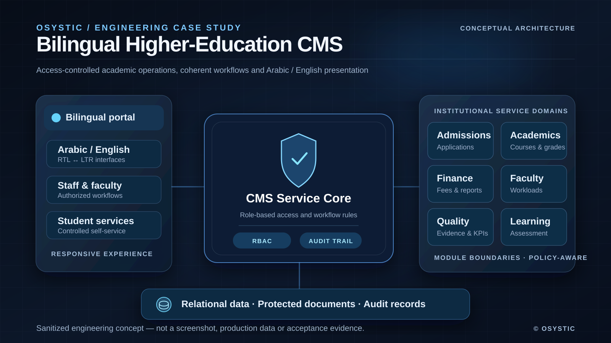
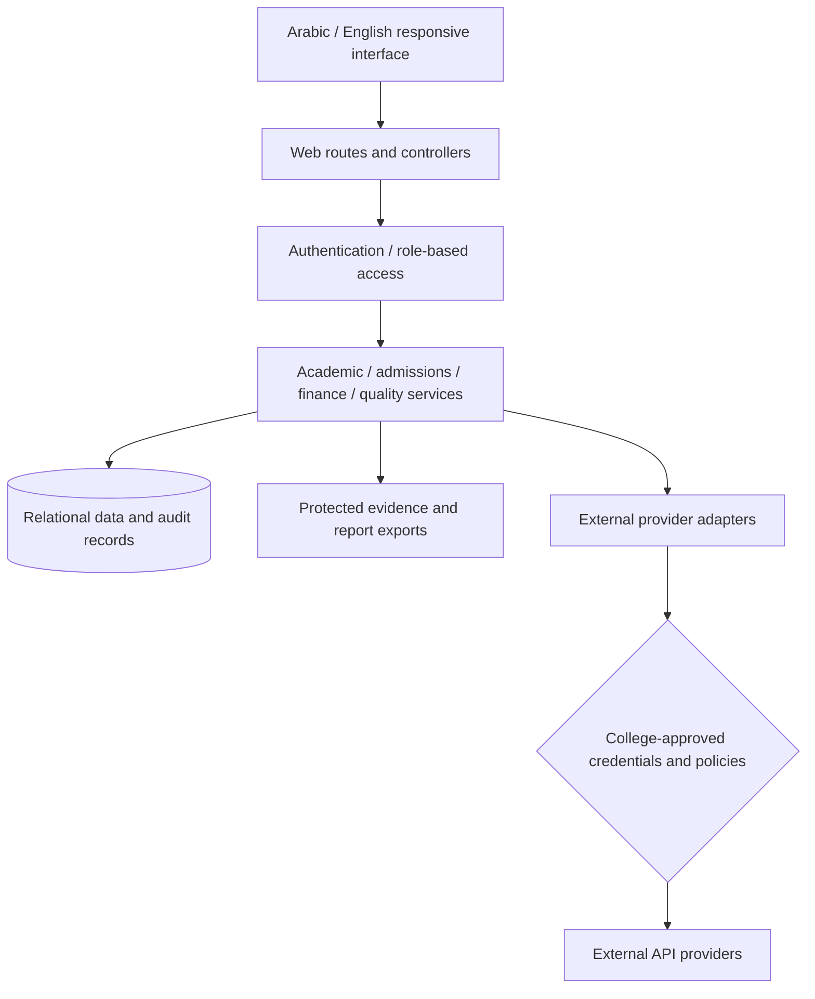

# Bilingual Higher-Education Management System

> **OSYSTIC · ENGINEERING CASE STUDY · PUBLIC SHOWCASE · SANITIZED**

## Executive summary

OSYSTIC engineered a bilingual Arabic/English college management platform using PHP, MariaDB and a modular, role-restricted service architecture. The documented technical delivery checkpoint covers admissions, academic administration, student services, finance, faculty workflows, quality assurance and learning-related operations. The work includes RTL/LTR presentation, protected records and a verification approach for permissions, workflows and deployment integrity.

The CMS reached a production technical-release verification checkpoint, **not a claim of final institutional acceptance**. College-specific academic policies, optional third-party integrations, incomplete translation/content and remaining end-user approval are separate follow-up requirements. This public repository describes a **sanitized engineering engagement**, not a deployable application, private client deliverable or permission to reproduce institutional information.

## Conceptual system architecture

*Original OSYSTIC editorial concept illustration. It is not an actual interface screenshot, a production architecture certification, student data or evidence of client sign-off.*

A confidential higher-education software engagement, documented at the engineering-capability level. **This repository is a case study, not an open-source application or a copy of the private client delivery.**

## Problem

A college administration platform must bring admissions, academic scheduling, student services, finance, faculty operations, quality assurance, online learning and executive reporting into consistent, permission-aware workflows. The solution also had to support both Arabic and English, mobile layouts, protected data, auditability and controlled integrations with institution-approved external services.

## Engineering approach

OSYSTIC developed a PHP/MariaDB web application with modular services, explicit access control, constrained public admissions endpoints, protected document storage, structured reports and a bilingual RTL/LTR presentation layer. External providers were abstracted behind integration boundaries rather than embedded credentials.

The architecture prioritizes **consistent data, reviewable permissions, secure deployment and source-level testability** over feature claims that have not been independently verified.

## Capabilities implemented

| Domain | Engineering focus |
|---|---|
| Academic management | Programs, course structures, registration, schedules and grades |
| Admissions | Online submissions, tracking, location/branch catalog administration |
| Student services | Self-service records, requests and notification preferences |
| Finance | Fee structures, invoices, payments, scholarships and reporting |
| Faculty operations | Workload, assignments, leave and teaching activity |
| Quality assurance | Learning-outcome mappings, KPIs, survey and evidence reporting |
| E-learning and executive operations | Assessments, permissions-aware assistance, analytical summaries |

## Architecture

## Engineering highlights

- Role-based authorization for staff, students and faculty, with negative-access testing.
- Bilingual interface catalogs, right-to-left layouts and mobile-width regression checks.
- Application integrity rules for admissions locations, enrollment capacity and academic scheduling.
- Protected document evidence, PDF/report outputs, encrypted backup and release-readiness processes.
- Test suites for regression, browser behavior, source parity and localized UI coverage.
- Controlled deployment to an isolated application path, separate from the institution's primary website.
- API-ready integration boundaries; **not** a claim that every optional third-party provider is connected.

## Outcome and verification boundary

The implemented CMS reached a production deployment and technical release-verification checkpoint. Internal testing covered application behavior, multilingual screen rendering, permissions and release consistency. Some institution-dependent provider integrations, policy sign-offs, live end-user acceptance and content translation remain outside the automatically verifiable checkpoint.

This case study **does not** claim full institutional sign-off, real merchant/Moodle/SMS/AI connectivity without provider authorization, guaranteed accessibility certification or redistribution rights for private source code.

## Ownership and handover

OSYSTIC's technical work and release-readiness evidence belong to the confidential project environment. The institution controls its operating accounts, academic rules, approvals and student/faculty data. Access credentials, private repository contents, production paths, original screenshots and operational runbooks are **not handed over through this public showcase**.

The implementation evidence documents a technical release checkpoint, while institutional acceptance, policy sign-offs, integrations and final content/localization verification remain distinct. This statement does not invent a handover receipt, unconditional source-ownership transfer, signed acceptance document or final go-live approval. Authorized private delivery and acceptance records must be verified in their own environment.

## Portfolio and confidentiality

Only generalized architecture, delivery practices and engineering lessons are published. **No client identity, original source, screenshots with student/college content, credentials, institutional endpoints or private database records appear here.**

Read [the full case study](case-study.md), [technical overview](docs/technical-overview.md), [validation](docs/validation-evidence.md), [disclosure boundary](docs/disclosure-boundary.md) and [publication notice](NOTICE.md).

**Status:** Completed engineering case study, maintained as a sanitized OSYSTIC portfolio artifact.
